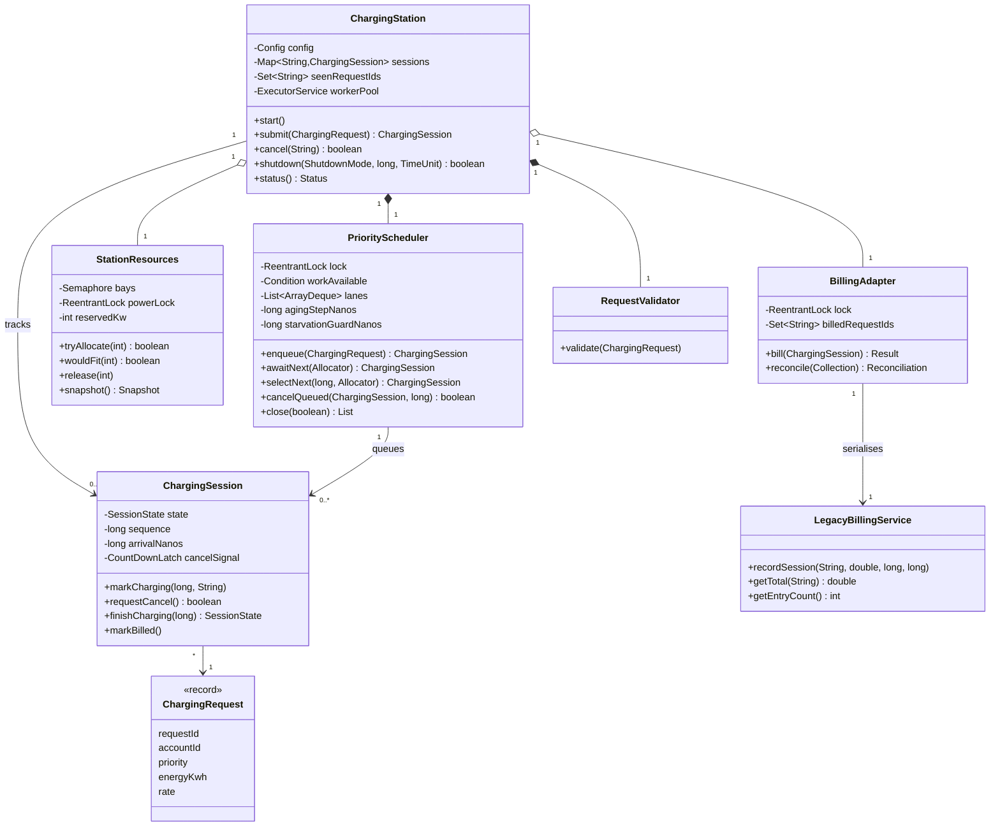
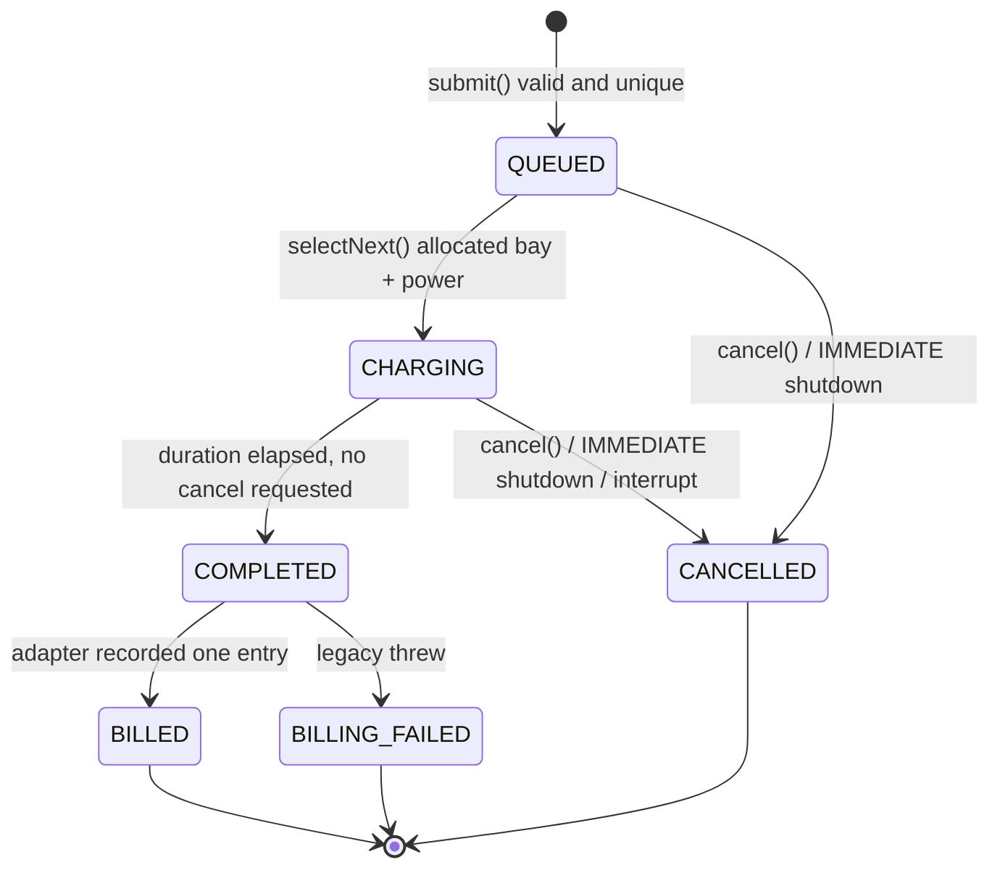
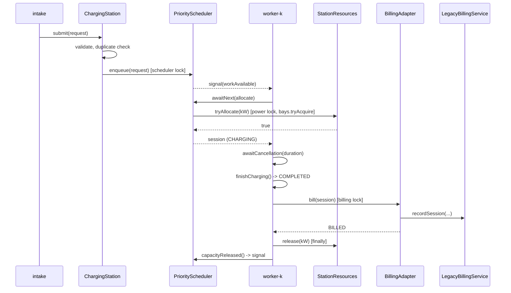

# SmartCharge — architecture and concurrency design

This document describes the implemented design. Every claim about behaviour links to a test or an
evidence file produced by actually running the code (see `docs/testing.md`, `docs/benchmark.md`).

## 1. Decomposition

| Package / class | Responsibility | Owns shared state? |
|---|---|---|
| `model` — `ChargingRequest`, `Priority`, `ChargingRate`, `SessionState` | Immutable request data and enums | No |
| `core.RequestValidator` | Field validation at intake (FR-02) | No (stateless) |
| `core.ChargingStation` | Intake, duplicate check, worker threads, session execution, cancellation, shutdown, status | `sessions` map, `seenRequestIds`, lifecycle, worker pool |
| `core.PriorityScheduler` | Pending queue (3 FIFO lanes), dispatch policy (priority, aging, backfill, guard), worker hand-off | Lanes, pending count, blocked-head timer — guarded by the **scheduler lock** |
| `core.StationResources` | Bays (counting `Semaphore(4, fair)`) and power budget (`int reservedKw`) | Guarded by the **power lock** |
| `core.ChargingSession` | One session's lifecycle state machine and timestamps | Its own fields — guarded by the **session monitor** |
| `billing.LegacyBillingService` | Brownfield stand-in, unsynchronised `ArrayList` + `HashMap`. Never modified | Its collections — only touched under the billing lock |
| `billing.BillingAdapter` | Serialises all legacy calls, exactly-once billing, reconciliation | `billedRequestIds`, failures — guarded by the **billing lock** |
| `workload.WorkloadGenerator`, `WorkloadDriver` | Seeded workload, replay on the `intake` thread | No |
| `app.Main`, `app.BenchmarkRunner`, `app.RunMetrics` | Normal run, experiment, metric definitions | No |
| `demo.DeadlockDemo` | Separate deadlock demonstration; not referenced by the station | Demo-local only |

Seven production classes carry all concurrent behaviour; the rest are data or drivers. Each piece of
shared state has exactly one guarding lock, named above.

## 2. Threads

| Thread name | Created by | Does |
|---|---|---|
| `main` / `bench` / `test-main` | JVM | Configures and shuts down the station |
| `intake` | `WorkloadDriver` | Submits requests at their scheduled arrival times |
| `worker-1..N` | fixed `ExecutorService` (pool modes) | Loop: `scheduler.awaitNext()` → `runSession()` |
| `req-thread-K` | `ChargingStation.submit` (thread-per-request mode) | One `awaitNext()` → `runSession()`, then exits |
| `monitor` | `Main` (daemon, scheduled) | Prints a `STATUS` line every 240 simulated minutes |

Workers *pull* work. A worker is handed a session only after its bay and power are already reserved, so
a waiting worker holds nothing. Consequently pool size bounds concurrency from above (pool-1 can never
use more than one bay), while the bay semaphore and power budget bound it independently of threads.

## 3. Synchronisation and lock order

| Lock | Guards | Acquired while holding |
|---|---|---|
| scheduler lock (`ReentrantLock` + `Condition workAvailable`) | queue lanes, blocked-head timer | nothing |
| power lock (`ReentrantLock`) | `reservedKw`, peaks; bay semaphore is only changed inside it | scheduler lock (during `selectNext`) or nothing (during `release`) |
| session monitor (`synchronized`) | session state | scheduler lock (`markCharging`, `cancelIfQueued`) or billing lock (`markBilled`) |
| billing lock (`ReentrantLock`) | legacy service, billed IDs | nothing |

The global order is **scheduler → power → session** and **billing → session**. No code path acquires them
in the reverse direction, and the session monitor never calls out while held, so the wait-for graph of
the production code is acyclic. The bay semaphore is only touched with the non-blocking `tryAcquire()`
or `release()`, both inside the power lock, so no thread ever blocks on a bay.

Visibility: all mutable shared fields are read and written under their lock; cross-thread hand-offs use
`ConcurrentHashMap`, `CountDownLatch` (cancellation signal), `volatile` (worker pool reference, log
flag) and `ExecutorService.awaitTermination`/`Thread.join` (happens-before at shutdown).

Wake-ups: `enqueue` and `capacityReleased` call `signal()` (one waiter), and a worker that successfully
takes a session chains a further `signal()` if work remains. This avoids a thundering herd when 200
`req-thread-K` threads are waiting. Because aging and the guard depend on time, not only on events,
waiters also re-evaluate after a bounded `awaitNanos` (≤ ¼ of the shorter of aging step and guard,
clamped to 1–100 ms), so no time-based decision is missed.

## 4. Scheduling policy

The queue is three FIFO lanes (one per base priority). `selectNext(now)` merges the lane heads by
`(effective priority, arrival sequence)`; each lane is already sorted by that key because an earlier
arrival in the same lane has waited at least as long, so the merge needs no sorting.

1. **Effective priority** = `max(1, base − ⌊waited / 30 sim-min⌋)` (FR-06).
2. Walk the merged order; the first request whose allocation succeeds starts (FR-05, FR-07).
3. When a later request starts ahead of a front request that could not fit (a backfill), start the
   guard clock for that front request if it is not already running. Once the same request is still the
   front 30 sim-min after its first overtake, return nothing until it fits itself (FR-08).

Why the clock starts at the first overtake (a design change made during evaluation): the first
version started it at the first *failed check* of the front request. Spare threads (pool-16,
thread-per-request) re-check every few milliseconds even when all 4 bays are busy, so the clock started
for requests that nobody had overtaken; pool-4 has no spare threads and only checked at releases. The
benchmark exposed this as ~100 guard activations per run for pool-16 / thread-per-request versus 0 for
pool-4 — the same workload was being scheduled by a different policy. Overtakes only happen at
release or arrival events, which every multi-worker configuration observes identically, so the policy is
now thread-count independent. The activation counter also only counts when the guard actually stops a
request that `wouldFit`. After the change: 0 activations in 11 of 12 benchmark runs, 1 in one
thread-per-request run (`evidence/benchmark-runs.csv`).

Worked example (from T17): a P1 fast request F cannot fit (only 9 kW free); P2 standard S1, S2 can.
At t=10 S1 backfills; at t=39 S2 backfills; at t=40 F has been the blocked front for 30 → nothing starts
even though S3 would fit; once 22 kW is free F starts, then S3. Observed: `[S1, S2, none, F, S3]`.

Design note from the benchmark: under the evaluated load average waits are ~10 simulated hours, far
longer than the 30-minute aging step, so almost every queued request is aged to level 1 and order
becomes near-FIFO (median P1/P2/P3 waits 539/606/637 sim-min for pool-4). The aging step is therefore
the main tuning knob for how much priority matters; a longer step would preserve more differentiation
at the cost of more visitor waiting.

## 5. Concurrency hazards

### H1 — Race condition / lost update on the power budget (prevented)

Unsafe version: `if (reservedKw + kw <= 60) { reservedKw += kw; }` with no lock.
State: one fast (22 kW) and one standard (7 kW) session running → `reservedKw = 29`, 2 bays free.

| Step | worker-1 (fast, 22 kW) | worker-2 (fast, 22 kW) | `reservedKw` |
|---|---|---|---|
| 1 | reads 29; 29+22=51 ≤ 60 ✓ | | 29 |
| 2 | | reads 29; 29+22=51 ≤ 60 ✓ | 29 |
| 3 | `bays.acquire()` succeeds | | 29 |
| 4 | | `bays.acquire()` succeeds | 29 |
| 5 | writes 29+22 = 51 | | 51 |
| 6 | | writes 29+22 = 51 (lost update) | 51 |

Result: four sessions draw 22+7+22+22 = **73 kW > 60 kW**, yet the ledger says 51 kW, so later checks
admit even more. Both the check-then-act and the read-modify-write are non-atomic.
Prevention: `tryAllocate` performs check, bay acquisition and update as one critical section under the
power lock. Evidence: T03, T06, T07, T18 and all 12 benchmark runs report peak ≤ 58 kW with assertions on.

The same hazard exists in the legacy billing service (`HashMap` get/put and `ArrayList.add`).
Observed in T13 without the adapter (`evidence/test-logs/T13.txt`): 5/5 trials corrupted, with
7,035–7,989 of 8,000 entries surviving and 6–322 kWh of totals lost. The amount varies strongly between
executions (an earlier development run lost ~3,500 entries per trial) because it depends on how threads
interleave — which is exactly why the race cannot be "tested away". With the adapter (T12): 8,001/8,001
entries, all totals exact, in every run.

### H2 — Deadlock (demonstrated separately, prevented in production)

See §6.

### H3 — Starvation

Two forms: (a) visitors overtaken forever by a stream of higher-priority requests — addressed by aging
(T16); (b) a large (fast) request overtaken forever by smaller backfilled requests — aging cannot help a
P1 request, so the starvation guard bounds it (T17). Limitation: bays, not power, are usually the
binding constraint for this workload, so backfill is rare (4 backfills in a 200-request run) and the
guard activated in only 1 of 12 benchmark runs; its behaviour is primarily evidenced by the
deterministic test T17.

### H4 — Priority inversion

Lock-level inversion is negligible: no lock is held across a blocking call, and critical sections are
a few field updates. The real inversion is physical and non-preemptive: a lower-priority session that
started by backfill keeps its bay and power while a higher-priority request waits. It is bounded by the
guard (backfill stops) and by session length; sessions are not pre-empted (A-01).

### H5 — Cancellation and completion race

A cancel may arrive exactly when charging ends. Both `requestCancel()` and `finishCharging()` are
`synchronized` on the session: if the cancel is applied first the session ends CANCELLED (not billed);
otherwise it ends COMPLETED and the cancel returns false. A queued-cancel and a dispatch race on the
scheduler lock instead: `markCharging` and `cancelIfQueued` both run under it. T08, T09.

## 6. Deadlock analysis

**Deadlock-prone design** (`DeadlockDemo.runDeadlockProne`): fast sessions lock the power ledger and
then block on `bays.acquire()`; standard sessions hold a bay and then block on the power ledger lock.
Latches force the interleaving: 4 standard threads take all 4 bays, `fast-1` takes the ledger.

```
Resource-allocation graph            Wait-for graph
  bay permit x4 ──held by──> std-1..4     std-1..4 ──> fast-1   (owner of ledger)
  power ledger  ──held by──> fast-1       fast-1   ──> std-1..4 (holders of all permits)
  std-1..4 ──requests──> power ledger     => cycle
  fast-1   ──requests──> bay permit
```

| Coffman condition | Present in demo | Production design |
|---|---|---|
| Mutual exclusion | yes (lock, permits) | yes — unavoidable for physical bays and the ledger |
| Hold and wait | yes | **removed**: `tryAcquire()` never blocks; a refused allocation holds nothing |
| No pre-emption | yes | yes — sessions are not pre-empted |
| Circular wait | yes | **removed**: single fixed order power lock → bay, never reversed |

Strategy: **prevention** (break hold-and-wait and circular wait), chosen over avoidance (Banker's
algorithm needs maximum claims and adds complexity for two resources) and detection/recovery (would
require aborting sessions and undoing reservations). Evidence: `evidence/deadlock-demo.txt` shows the
watchdog detecting no progress for 2 s, the thread dump (`std-k WAITING on ReentrantLock owner=fast-1`,
`fast-1 WAITING on Semaphore owner=null`), and that `ThreadMXBean.findDeadlockedThreads()` returns
`null` — a semaphore has no owner, so the JVM detector cannot see this cycle; a timeout watchdog can.
The corrected variant with the same threads and interleaving completes (T20).

## 7. Design contracts (as enforced in code)

| # | Operation | Preconditions | Postconditions | Invariant | Enforcement | Req | Tests |
|---|---|---|---|---|---|---|---|
| C1 | `StationResources.tryAllocate(kw)` | kw > 0 | true ⇒ reservedKw′ = reservedKw + kw ∧ activeBays′ = activeBays + 1; false ⇒ no change | 0 ≤ reservedKw ≤ 60 ∧ 0 ≤ activeBays ≤ 4 | `IllegalArgumentException`; power lock; `assert invariantHolds()` | FR-09, FR-10, NFR-01 | T03, T06, T07, T18, T20 |
| C2 | `StationResources.release(kw)` | a matching allocation of kw is held | reservedKw′ = reservedKw − kw ∧ activeBays′ = activeBays − 1 | as C1 | `IllegalStateException` on unmatched release; `assert` | FR-17 | T09, T10, T14 |
| C3 | `BillingAdapter.bill(s)` | s is COMPLETED, or s was already billed | first call: exactly one new legacy entry and s is BILLED, or no entry and s is BILLING_FAILED; later calls: no entry (DUPLICATE_IGNORED) | legacy entries = number of BILLED sessions | billing lock; `IllegalStateException`; `assert` entry count grew by 1 | FR-13, FR-14, FR-16 | T12, T14, T15 |
| C4 | `PriorityScheduler.selectNext(now, alloc)` | caller may hold the scheduler lock (re-entrant) | returns null, or a session that is removed from the queue and whose allocation succeeded; no queued session ahead of it in (effective priority, sequence) order could start, unless the guard blocks backfill | pending = Σ lane sizes | scheduler lock; ordering by `MergedOrder` | FR-05–FR-08 | T04, T16, T17 |
| C5 | `ChargingSession` transitions | current state matches the transition's source state | state follows the state machine in §8 | terminal states never change | `synchronized`; `IllegalStateException` | FR-12, FR-14 | T08–T11 |
| C6 | `ChargingStation.shutdown(mode)` | station RUNNING | all station threads terminated ∧ reservedKw = 0 ∧ activeBays = 0 ∧ no session QUEUED/CHARGING | — | lifecycle CAS; `assert` after termination | FR-19 | T10, T11 |

## 8. Models (implementation-aligned)

### Class model



### Session state machine



Resources are held exactly while the session is CHARGING or COMPLETED (billing happens before the
`finally` that releases them).

### Sequence: request arrival → billing → release



### Use cases

| Actor | Use case |
|---|---|
| Driver (fleet/emergency, staff, visitor) | Submit charging request; cancel request |
| Station operator | Start station; view status; shut down (graceful / immediate) |
| Legacy billing system | Record completed session |
| Engineer | Run tests; run deadlock demo; run benchmark |

## 9. Known limitations

- Sessions are not pre-empted; a running low-priority session keeps its bay (H4).
- Billing failure has no retry (A-07); failed sessions are reported, not re-billed.
- Timing uses timed waits on a scaled clock; every session overruns its nominal length by ~3.2–3.9
  sim-min (ms) on the test machine (`avg_overrun_sim_min` in the benchmark CSV), equally across
  configurations.
- The starvation guard rarely activates under the evaluated workload; it is verified mainly by T17.
- `start()` must be called once by the owning thread; it is not designed for concurrent callers.
